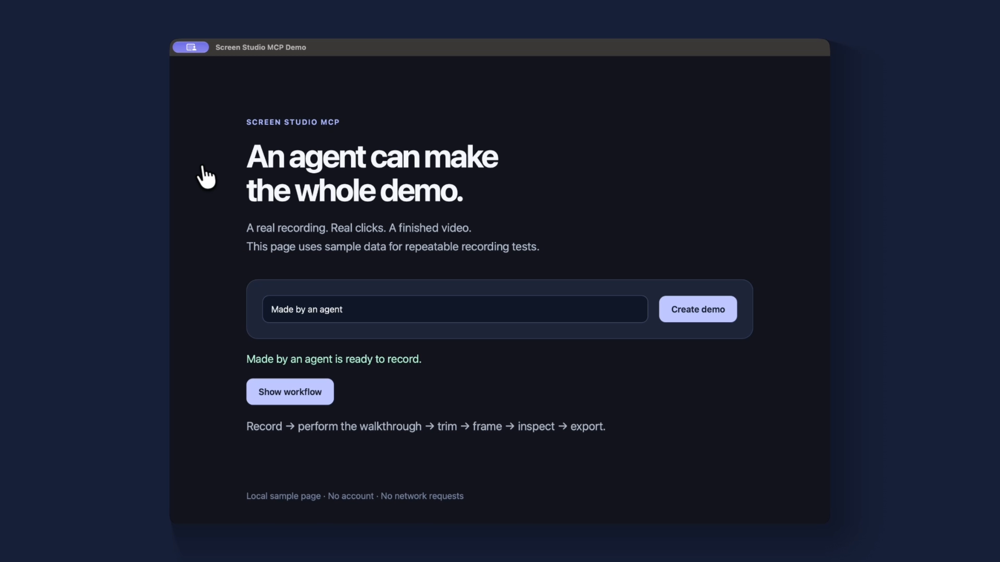

# Screen Studio MCP

An unofficial local MCP server for Screen Studio 4. An agent can record an app, perform the walkthrough with visible native clicks and typing, edit the project, render a video, and inspect the actual output.

Forked from [screenstudio-agent](https://github.com/HyperfocuSam/screenstudio-agent), originally based on [screenstudio-cli](https://github.com/ShawnPana/screenstudio-cli). MIT licensed. Not affiliated with Screen Studio.

[Watch the actual agent recording](examples/demo.mp4).



## Compatibility

**Tested with Screen Studio 4.0.1-4897 on Apple Silicon macOS.** Mutating app operations require that build. Version 4 changed both project settings and timeline structure; this adapter uses its nested configuration and scene data. Screen Studio has no supported public automation API, so an app update may require adapter changes.

This is a working development version, not a stable release. See [feature coverage](docs/compatibility.md) for supported controls and UI fallbacks.

## Install

Requirements: macOS, licensed Screen Studio 4.0.1-4897, Node 22 or newer, Xcode command line tools, and `ffmpeg` / `ffprobe` on PATH.

```sh
git clone https://github.com/tolimarchuk/screenstudio-mcp.git
cd screenstudio-mcp
git switch toli/mcp-and-agent-skills
npm ci
npm run build
npm run build:native
```

Add to your MCP client's configuration, replacing the example installation directory:

```json
{
  "mcpServers": {
    "screenstudio": {
      "command": "node",
      "args": ["/your/install/screenstudio-mcp/dist/mcp/main.js"]
    }
  }
}
```

Quit Screen Studio normally before the first connection, then let the agent launch it. The server starts a debugging connection restricted to loopback. A running app is never killed or restarted. Its control connection is powerful: keep it local and close the app when done.

For native input, macOS must allow Accessibility for the desktop helper. Window screenshots and recording need Screen Recording access. The server reports missing permissions; it never changes them automatically.

Install the three skill directories into your agent's skill directory: `screenstudio-record`, `screenstudio-edit`, `screenstudio-deliver`. The server also provides a demo prompt and workflow, recovery and compatibility resources. The old `screenstudio-cli` skill in `legacy/` and CLI source remain upstream history and are unsuitable for this version 4 workflow.

## What agents can do

- Inspect actual windows, displays, microphones, cameras and recording state.
- Record one exact window or display, pause/resume, mark beats and finish into a saved project.
- Focus, smoothly move, click, type, send basic keys and scroll on an observed native window.
- Read and duplicate projects, apply revision-checked edits and restore saved checkpoints.
- Trim and speed up source intervals; add screen or loupe zooms.
- Adjust nested cursor, caption, audio, webcam, layout, background and framing settings.
- Render local MP4/GIF exports with job status/cancel; inspect encoded properties and actual rendered frames.
- Read an existing transcript without starting transcription or uploading audio.

Transcript generation/editing, filler removal, voiceover generation, timeline layouts and mask editing currently use Screen Studio's UI through the host agent's computer controls. Existing project data for these features is preserved.

## A good recording workflow

1. Identify the exact target and rehearse 3–5 meaningful beats.
2. Start capture with camera and audio off by default.
3. Screenshot and inspect the target before each action. Use a fresh observation token and visible native input.
4. Finish and retain the returned project. Duplicate before editing.
5. Trim waiting, frame the app and add purposeful zooms.
6. Render, poll to completion, inspect first/middle/last frames and every transition, then deliver the video.

[Agent workflow](docs/agent-workflow.md) includes examples, coordinate mapping and recovery. [Architecture](docs/architecture.md) describes the local integration and failure behavior.

## Configuration

| Variable | Default | Purpose |
| --- | --- | --- |
| `SCREENSTUDIO_PORT` | `9222` | Local app debugging port, 1024–65535 |
| `SCREENSTUDIO_APP_PATH` | `/Applications/Screen Studio.app` | App bundle to launch |
| `SCREENSTUDIO_STATE_DIR` | `~/.screenstudio-mcp` | Private checkpoints, export metadata and preview frames |
| `SCREENSTUDIO_FFMPEG` | `ffmpeg` | Executable for extracting rendered frames |
| `SCREENSTUDIO_FFPROBE` | `ffprobe` | Executable for checking actual exports |

Protocol messages use stdout. Errors are returned as MCP error content; no shell command or arbitrary JavaScript execution operation is exposed.

## Development and tests

```sh
npm test                  # protocol, connection and project behavior
npm run build:native      # native helper compilation
npm run check             # both
```

Desktop integration is opt-in and records only a seeded sample. See [live tests](docs/testing.md) to repeat recording, native interaction, editing and export. Test artifacts stay outside Git.

Nothing is published to npm or installed into an agent client automatically. The public fork contains source; the implementation is on the development branch until integrated.
